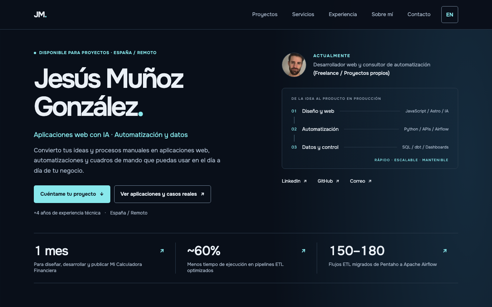

# Jesus Munoz Gonzalez - Data & Agentic Engineering Portfolio



Modern personal portfolio built with Astro and Tailwind CSS. It presents my work across data engineering, agentic engineering workflows, and production-focused project delivery.

## What this portfolio highlights

- Data engineering work on scalable ETL pipelines, orchestration, and reliability.
- Agentic engineering workflows using Claude Code, OpenCode, and Codex to ship production-ready systems.
- A featured case study showing how these practices were applied in a live product.

## Agentic engineering approach

This portfolio and featured project reflect a practical engineering workflow:

- Scoped planning and execution loops for each feature.
- Tool-assisted coding sessions with Claude Code, OpenCode, and Codex.
- Reusable skills and hooks to keep implementation quality consistent.
- Validation gates (review, checks, and final build verification) before release.

## Tech stack

- Astro
- Tailwind CSS
- TypeScript / JavaScript

## Run locally

```bash
npm install
npm run dev
```

Build and preview production output:

```bash
npm run build
npm run preview
```

## Available scripts

- `npm run dev` - Start development server.
- `npm run start` - Alias of dev server.
- `npm run build` - Run Astro checks and build production assets.
- `npm run preview` - Preview the built site locally.
- `npm run astro` - Run Astro CLI commands directly.

## Project structure

```text
src/
  components/   Reusable UI blocks for each section
  data/         Portfolio content source (copy and project details)
  pages/        Route entrypoints
public/
  projects/     Project screenshots and static visual assets
```

## Featured project

- Mi Calculadora Financiera: https://micalculadorafinanciera.com/

## Contact

- Email: mailto:jesusmugo91@gmail.com
- LinkedIn: https://linkedin.com/in/jesus-data-engineer
- GitHub: https://github.com/Quejicus
