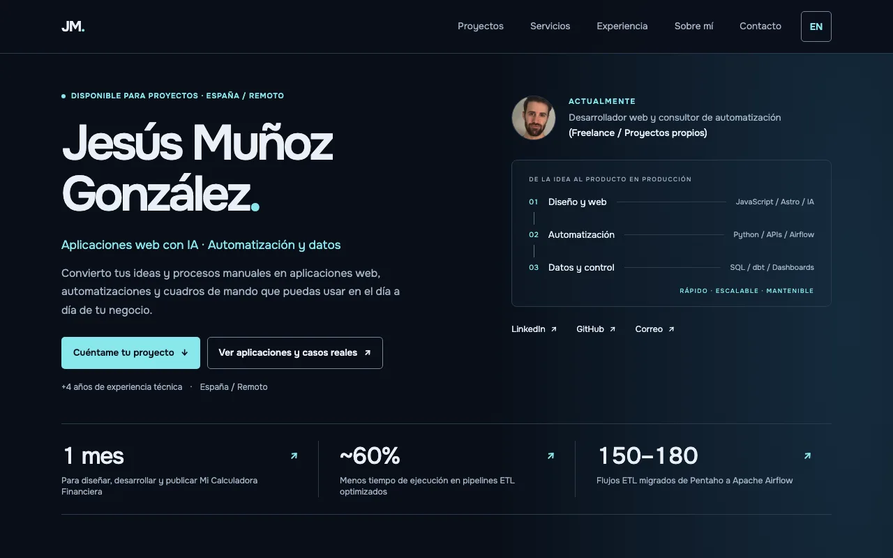

# Jesús Muñoz González · Analytics & Data Engineer

[Live portfolio](https://jesus-dataengineer-portfolio.netlify.app/) · [LinkedIn](https://linkedin.com/in/jesus-data-engineer) · [Email](mailto:jesusmugo91@gmail.com)



A static Astro portfolio focused on analytics engineering with dbt and SQL, backed by Airflow migrations, PySpark ETL optimisation, cloud delivery and independently built products. Professional claims are grounded in the supplied CV; case studies distinguish reported results from unverified details.

## Development

Use Node 24 (see `.nvmrc`; minimum supported: 22.12).

```sh
npm ci
npm run dev
```

## Verification

```sh
npm run build
npx playwright install chromium webkit
npm test
npm run budget
```

The build runs a strict Astro check and refuses a zero-file/partial-source check. Browser tests cover Chromium and WebKit, 320/390/768/1280px widths, accessibility checks, keyboard and anchor navigation, CV and metadata, clipboard feedback, no-JavaScript navigation, and local event hooks. These automated checks complement—not replace—manual review.

`npm run preview` serves the built files. Astro may background the preview in agent environments; `npm run astro -- preview stop` stops that process.

## Content and assets

- `src/data/portfolio.ts`: profile, professional experience, metrics, credentials and reviewed date.
- `src/data/work.ts`: the four project overviews; each automatically gets a route and sitemap entry.
- `astro.config.mjs`: the single production origin used for canonical URLs, structured data, sitemap and robots.
- `src/styles/global.css`: shared design tokens and responsive layouts. Native CSS; no client framework or page-transition router.
- `public/CV_Data_Engineer_2026.pdf`: the authorised public CV. Review personal information before replacing it.
- `assets/portfolio-og.svg`: editable 1200 × 630 social preview; run `npm run assets:og` to generate the PNG.
- `npm run assets:screenshot`: capture the production homepage and refresh its PNG and WebP versions. Run the build first, then rebuild afterward to include the new images in `dist`.

Screenshots are taken from a production preview, with fonts loaded and without the development toolbar. The existing PNG URL is retained for compatibility; this README uses the smaller WebP. Social cards use a dedicated identity image rather than a miniature webpage.

## Deployment

Netlify serves `dist` using `npm run build` and Node 24, configured in `netlify.toml`. GitHub Actions checks pull requests and pushes to main. This work does not change hosting providers.

Before release, follow [the maintenance checklist](docs/maintenance.md). A local implementation is not deployed until its changes are committed, pushed and successfully built by Netlify.

## Analytics

Links emit a local `portfolio:interaction` custom event with only `{ name, path }`. No analytics provider, cookies, network transport or persistent storage is installed. Do Not Track disables the hook. Event names include `cv_download`, `project_open`, `project_live`, `contact_email` and `contact_link`.

A provider integration remains an explicit deployment decision. Validate privacy requirements and avoid collecting email URLs, CV contents or other personal data.

## Content boundaries

No invented client architecture, certificate verification links, user counts or unverified performance claims. The ambiguous “80% improvement” has been omitted. The ~60% figure means a reduction in end-to-end runtime. Credential dates describe when they were earned, not a claim of current renewal status.

The PC optimisation project has an overview but no fabricated repository/demo link. Add verified links and measurements when available.
